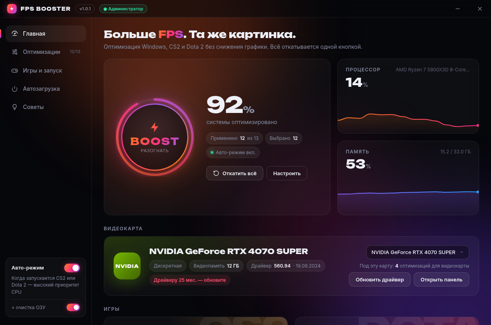
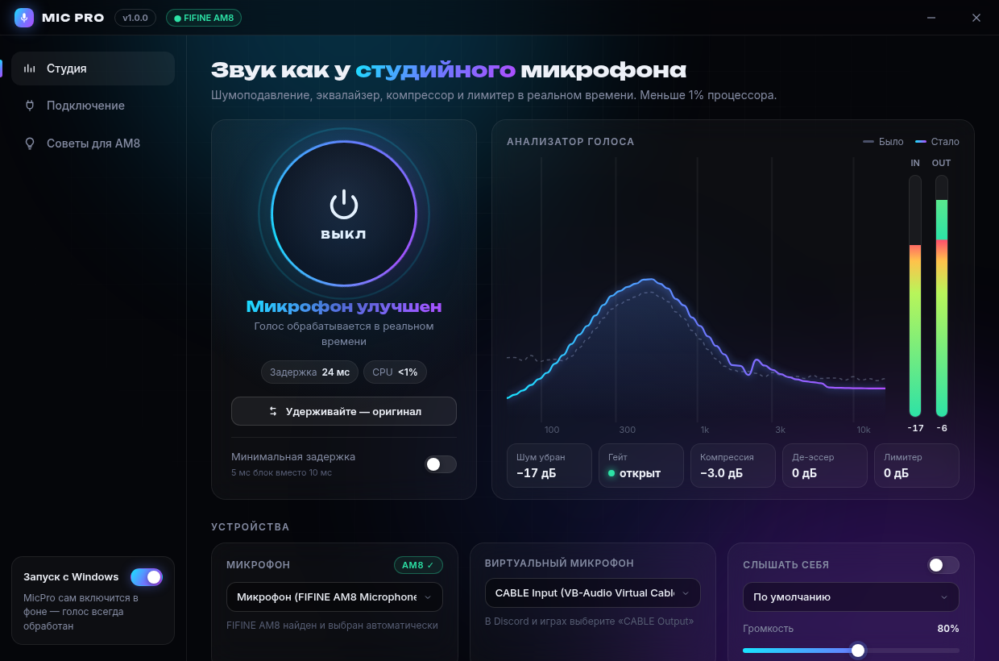

# ⚡ FPS Booster — CS2 & Dota 2

Программа для Windows 10/11, которая поднимает FPS в **Counter-Strike 2** и **Dota 2** и ускоряет весь ПК, **не снижая качество графики**. Ни один пункт не трогает разрешение, текстуры, тени и другие настройки картинки. Все изменения сохраняются в резервную копию и откатываются одной кнопкой.



## Что делает

### Для видеокарты — NVIDIA, AMD, Intel
Программа сама находит все видеокарты (через DirectX), показывает модель, видеопамять, версию и возраст драйвера и подбирает оптимизации под выбранную карту. Если карт несколько (например, ноутбук со встроенной и дискретной), нужную можно выбрать в списке.

| Оптимизация | Для каких карт | Что даёт |
|---|---|---|
| Игры всегда на выбранной видеокарте | все | CS2 и Dota 2 запускаются строго на ней. На ноутбуках с двумя GPU это самый большой прирост, если игра раньше уходила на встроенную графику. |
| Драйвер NVIDIA: профиль CS2 и Dota 2 | NVIDIA | Через официальный NVAPI, как в «Панели управления NVIDIA», но только для этих игр: электропитание «Максимальная производительность» и режим низкой задержки «Вкл.». Прежние значения сохраняются для отката. |
| Оптимизация игр в окне | все, Windows 11 | В режиме «Окно без рамки» игра работает так же быстро, как в полноэкранном. |
| HAGS (аппаратное планирование GPU) | NVIDIA GTX 10xx+/RTX, AMD RX 5000+, Intel Arc | Включается по умолчанию только там, где карта это поддерживает. |

Для AMD и Intel программа показывает короткий список того, что стоит включить вручную в Adrenalin или Intel Graphics Software (Anti-Lag, Resizable BAR и т.п.), и открывает эту программу кнопкой. Если драйверу больше полугода, появится напоминание и кнопка «Обновить драйвер».

### Для игр
| Оптимизация | Что даёт |
|---|---|
| Безопасный `autoexec.cfg` | В игре снимается лимит FPS, в меню FPS ограничивается (GPU меньше греется), отключаются подсказки и анимация меню. Ваш конфиг остаётся как был: программа добавляет только свой помеченный блок. |
| Игровой режим Windows | Windows отдаёт игре приоритет и не ставит обновления во время матча. |
| Отключение Xbox Game DVR | Фоновая запись геймплея больше не расходует GPU и диск. |
| **Авто-режим** | Когда запускаются `cs2.exe` или `dota2.exe`, программа ставит им высокий приоритет CPU (не realtime) и может очистить ОЗУ. |

### Для всего ПК
| Оптимизация | Что даёт |
|---|---|
| Схема питания «Максимальная производительность» | Процессор не сбрасывает частоты между кадрами: меньше просадок и фризов. |
| Приоритет игр в планировщике (MMCSS) | Фреймтайм и пинг становятся ровнее. |
| Отключение Power Throttling | Windows перестаёт урезать частоты Steam, Discord и античиту. |
| Запрет фоновой работы приложений Store | Почта, Погода, Xbox и т.п. не расходуют CPU и ОЗУ в фоне. |
| Быстрый интерфейс Windows | Меню открываются без задержки, окна сворачиваются без анимаций. |
| Отключение прозрачности *(выкл. по умолчанию)* | Немного разгружает GPU на рабочем столе. |
| Очистка ОЗУ | Сбрасывает standby-кэш, как это делают RAMMap и ISLC. Помогает от микрофризов, когда памяти мало. |
| Очистка temp | Удаляет временные файлы старше суток. |
| Автозагрузка | Отключает лишние программы при старте Windows, так же как Диспетчер задач. |

Во вкладке «Игры и запуск» лежат готовые параметры запуска Steam с кнопкой «Копировать», а во вкладке «Советы» — что ещё можно сделать вручную (XMP, драйверы, настройки NVIDIA и AMD).

### Чего программа специально не делает
- не понижает графику и разрешение;
- не трогает файлы игры, только стандартный `autoexec.cfg`, поэтому это безопасно для VAC;
- не ставит realtime-приоритет, потому что он может подвесить звук и мышь;
- не отключает Защитник Windows и обновления.

> Прирост FPS зависит от конкретного ПК. Обычно становится меньше просадок и ровнее фреймтайм. Сильнее всего это заметно на ноутбуках и системах, где раньше стояла экономичная схема питания. Самый большой бесплатный прирост часто даёт включённый XMP/EXPO в BIOS (см. «Советы»).

## Как запустить

### Вариант 1: готовый `.exe`
**[⬇ Скачать FPSBooster.exe](../../releases/latest/download/FPSBooster.exe)** (последняя сборка).

GitHub Actions собирает exe при каждом пуше в эту ветку и публикует его в Releases вместе с файлом `SHA256SUMS.txt`. Запустите файл и подтвердите запрос администратора.

### Антивирус ругается?
Это ложное срабатывание. Exe упакован PyInstaller: внутри лежат Python и код программы. Тем же упаковщиком пользуются и авторы вирусов, поэтому часть антивирусов (в основном «Static ML» и эвристики вида `BehavesLike…`) помечает почти любой такой файл. Чтобы ошибок было меньше:
- загрузчик PyInstaller собирается из исходников прямо в GitHub Actions, поэтому он не совпадает с загрузчиками из чужих сборок;
- у exe есть иконка и сведения о версии и издателе;
- программа вообще не выходит в интернет: шрифты встроены, ничего не скачивается и не отправляется.

Убедиться, что файл не подменён, можно так: сравните SHA256 файла (VirusTotal → Details) со строкой из `SHA256SUMS.txt` в релизе. Полностью убрать предупреждения может только платная цифровая подпись кода.

### Вариант 2: собрать самому
1. Установите [Python 3.10+](https://www.python.org/downloads/) и при установке отметьте «Add to PATH».
2. Запустите `build.bat`.
3. Готовые файлы появятся в `dist\FPSBooster.exe` и `dist\MicPro.exe`.

### Вариант 3: из исходников
```bat
pip install -r requirements.txt
python -m fps_booster
```

Интерфейс работает на Edge WebView2, который уже встроен в Windows 10/11.

### Консольный режим
```bat
python -m fps_booster --list              :: список игр и оптимизаций
python -m fps_booster --apply             :: применить рекомендуемые
python -m fps_booster --apply mmcss hags  :: применить выбранные
python -m fps_booster --revert            :: откатить всё
```

## Откат
Кнопка **«Откатить всё»** возвращает исходные значения реестра и прежнюю схему питания, а из `autoexec.cfg` убирает только блок программы. Резервная копия хранится в `%APPDATA%\FPSBooster\backup.json`. Если оптимизацию применить повторно, исходное значение в копии не перезаписывается.

## Разработка
```
fps_booster/
  api.py       мост между интерфейсом и Python (pywebview js_api)
  app.py       окно приложения
  ui/index.html интерфейс (HTML/CSS/JS)
  tweaks.py    оптимизации с бэкапом и откатом
  gpu.py       видеокарты: DXGI, драйвер, производитель, панели NVIDIA/AMD/Intel
  nvidia.py    профили драйвера NVIDIA через NVAPI (DRS)
  games.py     поиск Steam, CS2, Dota 2 и работа с autoexec.cfg
  system.py    очистка ОЗУ и temp, автозагрузка
  watcher.py   авто-приоритет для запущенных игр
  vdf.py       парсер форматов Steam (VDF/ACF)
tests/         pytest
buildtools/    сборка exe: иконки, сведения о версии, build.py
```
- Тесты: `pip install psutil numpy scipy pytest && python -m pytest`.
- Дизайн можно смотреть без Windows: откройте `fps_booster/ui/index.html` в браузере, и он запустится в демо-режиме с тестовыми данными.

---

# 🎙 MicPro — студийный звук для микрофона

Вторая программа в этом репозитории. Она в реальном времени обрабатывает голос с **FIFINE AM8** (или любого другого микрофона), чтобы он звучал как у стримеров: чисто, плотно, разборчиво и без шума. Процессор при этом почти не нагружается.



**[⬇ Скачать MicPro.exe](../../releases/latest/download/MicPro.exe)**

## Цепочка обработки
| Модуль | Что делает |
|---|---|
| Срез низа | Убирает гул, удары по столу и «пух» от дыхания. |
| Шумоподавление | Спектральный фильтр Эфраима–Малаха: убирает шум вентиляторов и ПК без «бульканья». |
| Шумовой гейт | В паузах полная тишина, клавиатуру не слышно. Начало слова не обрезается. |
| Эквалайзер | Настроен под динамический AM8: бархат 150 Гц, срез бубнежа 350 Гц, чёткость 4 кГц, «воздух» 11 кГц. |
| Де-эссер | Смягчает резкие «с», «ш», «ч». |
| Компрессор | Шёпот и крик звучат на одном уровне. |
| Лимитер | Звук никогда не хрипит и не перегружает Discord. |

Четыре пресета: «Стрим», «Discord / игры», «Подкаст», «Натуральный». Кнопку «Удерживайте — оригинал» можно зажать, чтобы сравнить с исходным звуком.

## Нагрузка и задержка
- Обработка блоками по 10 мс (в режиме «Минимальная задержка» по 5 мс), векторно на numpy/scipy. На облачном сервере это ~5% одного ядра, на обычном игровом ПК меньше 1% всего процессора.
- Когда окно свёрнуто, анализатор и анимации останавливаются.
- Итоговая задержка обычно 20–35 мс, как у NVIDIA Broadcast. В разговоре она не заметна.
- Вход и выход разделены кольцевым буфером с контролем дрейфа, поэтому звук со временем не «уплывает» и не щёлкает.

## Как подключить
1. Установите бесплатный [VB-Cable](https://vb-audio.com/Cable/) и перезагрузите ПК.
2. Запустите MicPro и нажмите кнопку питания. AM8 и VB-Cable находятся автоматически.
3. В Discord, OBS и других программах выберите микрофон **CABLE Output**. В Discord отключите Krisp, эхоподавление и автоусиление.
4. Для игр назначьте **CABLE Output** устройством записи по умолчанию в Windows.

Подробные шаги есть во вкладке «Подключение», советы по постановке AM8 — во вкладке «Советы для AM8».
